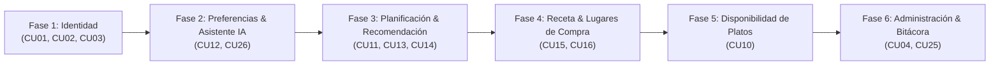

# Plan de Pruebas: Bloque 1 - Persona 1 (13 Casos de Uso)
**Sistema:** MenuOpt (Planificación y Recomendación Gastronómica Inteligente)  
**Entorno de Ejecución:** Local (`http://localhost:4200` | API: `http://localhost:8000`)  
**Fecha:** Noviembre 2026  

---

## 1. Información General y Cuentas de Acceso

Para ejecutar este plan de pruebas de punta a punta, utiliza las siguientes cuentas de prueba ya sembradas en la base de datos:

| Rol | Correo Electrónico | Contraseña | Propósito en las Pruebas |
| :--- | :--- | :--- | :--- |
| **Administrador** | `admin@menuopt.com` | `admin123` | Probar CU04 (Usuarios) y CU25 (Bitácora/Auditoría). |
| **Cliente Principal** | `cliente1@menuopt.com` | `cliente123` | Probar CU01, CU02, CU03, CU11, CU12, CU13, CU14, CU15, CU16, CU26. |
| **Restaurante** | `restaurante@menuopt.com` | `restaurante123` | Probar CU10 (Gestión de disponibilidad de platos/productos). |
| **Cliente Nuevo** | *(A registrar en la prueba)* | *(Libre)* | Probar flujo de registro nuevo (CU01). |

---

## 2. Flujo de Ejecución Rápido Recomendado (E2E)

Para una verificación fluida y sin repetir inicios de sesión innecesarios, se sugiere seguir este orden:

---

## 3. Guía Paso a Paso de los 13 Casos de Uso

### CU01: Registrar usuario
* **Ruta:** `http://localhost:4200/registro`
* **Rol:** Usuario no autenticado (Público).
* **Objetivo:** Permitir a una persona crear una cuenta nueva en la plataforma.
* **Pasos:**
  1. Si tienes una sesión abierta, pulsa **Cerrar Sesión** en el menú superior.
  2. Haz clic en **Registrarse** o entra a `/registro`.
  3. Ingresa los datos:
     - **Nombre:** `Prueba Tester`
     - **Correo electrónico:** `tester1@menuopt.com`
     - **Teléfono:** `77012345`
     - **Contraseña:** `Tester123*`
     - **Confirmar contraseña:** `Tester123*`
  4. Haz clic en **Crear Cuenta**.
* **Resultado Esperado:** 
  - Mensaje de confirmación exitoso.
  - Redirección automática a la pantalla de `/login` con el correo prellenado o listo para ingresar.
* **Prueba Negativa:** Intentar registrar el mismo correo nuevamente; debe mostrar una alerta de error indicando que el correo ya está registrado.

---

### CU02: Iniciar sesión
* **Ruta:** `http://localhost:4200/login`
* **Rol:** Público.
* **Objetivo:** Autenticar al usuario y generar su sesión segura (JWT).
* **Pasos:**
  1. En `/login`, ingresa:
     - **Correo:** `cliente1@menuopt.com`
     - **Contraseña:** `cliente123`
  2. Haz clic en **Ingresar**.
* **Resultado Esperado:**
  - Acceso inmediato al **Dashboard del Cliente** (`/inicio`).
  - El encabezado muestra el nombre del usuario y su rol (`CLIENTE`).
* **Prueba Negativa:** Ingresar contraseña errónea (`cliente999`); el sistema debe rechazar el acceso con una alerta clara sin cerrar la aplicación.

---

### CU03: Gestionar perfil y contraseña
* **Ruta:** `http://localhost:4200/perfil`
* **Rol:** Usuario Autenticado (`cliente1@menuopt.com`).
* **Objetivo:** Modificar datos personales y actualizar la contraseña del usuario.
* **Pasos:**
  1. En el menú superior o barra de navegación, pulsa en tu avatar o selecciona **Mi Perfil**.
  2. Modifica el campo **Teléfono** (ej: cambiar a `70099887`).
  3. Pulsa **Guardar Cambios**.
  4. En la sección de seguridad, ingresa:
     - **Contraseña actual:** `cliente123`
     - **Nueva contraseña:** `cliente123` *(puedes mantener la misma o cambiarla)*
  5. Pulsa **Actualizar Contraseña**.
* **Resultado Esperado:**
  - Los datos del perfil se actualizan en pantalla y se muestra una notificación de éxito.
  - La verificación de la contraseña anterior es estricta (no permite cambios si la contraseña actual no coincide).

---

### CU04: Administrar usuarios
* **Ruta:** `http://localhost:4200/admin/usuarios`
* **Rol requerido:** Administrador (`admin@menuopt.com` / `admin123`).
* **Objetivo:** Visualizar todos los usuarios del sistema, activar/desactivar cuentas y verificar permisos.
* **Pasos:**
  1. Inicia sesión como `admin@menuopt.com`.
  2. En la barra de navegación lateral o menú superior, ingresa a **Administración > Usuarios**.
  3. Observa la tabla de usuarios registrados (debes ver clientes, restaurantes, tiendas y administradores).
  4. Selecciona un usuario cliente y pulsa el botón de cambio de estado (ej: **Desactivar** / **Activar**).
* **Resultado Esperado:**
  - La tabla carga correctamente con roles y estados vigentes.
  - Al cambiar de estado, se actualiza el badge a `INACTIVO` o `ACTIVO`.
  - Un usuario con rol `CLIENTE` no puede acceder a esta URL (debe ser redirigido o bloqueado por el `roleGuard`).

---

### CU10: Gestionar disponibilidad de productos y platos
* **Ruta:** `http://localhost:4200/restaurantes/1/platos` (o mediante sesión de restaurante).
* **Rol:** Restaurante (`restaurante@menuopt.com`) o Administrador.
* **Objetivo:** Activar o desactivar la disponibilidad de un plato para que el algoritmo de recomendación no lo sugiera a los clientes cuando se agote.
* **Pasos:**
  1. Accede con rol de Restaurante o Administrador a la gestión de platos del restaurante.
  2. Localiza un plato (ej: *"Cuarto de Pollo Broaster"*).
  3. Cambia su switch o botón de **Disponible** a **No Disponible**.
  4. Guarda el cambio.
* **Resultado Esperado:**
  - El estado del plato pasa a `No Disponible`.
  - Al generar recomendaciones para una planificación posterior, dicho plato no debe incluirse en los menús sugeridos.

---

### CU11: Crear planificación gastronómica
* **Ruta:** `http://localhost:4200/planificaciones/nueva`
* **Rol:** Cliente (`cliente1@menuopt.com`).
* **Objetivo:** Definir el presupuesto, comensales, tipo de comida y zona para que el sistema optimice las comidas.
* **Pasos:**
  1. Inicia sesión como `cliente1@menuopt.com`.
  2. Dirígete a **Mis Planificaciones** y pulsa **+ Nueva Planificación**.
  3. Rellena el formulario con estos datos:
     - **Tipo de Comida:** `CENA` (o `ALMUERZO`)
     - **Cantidad de Comensales:** `2`
     - **Presupuesto Total (Bs):** `200.00`
     - **Ubicación de Referencia:** `equipetrol`
     - **Fecha prevista:** Fecha de hoy o mañana.
  4. Haz clic en **Guardar Planificación**.
* **Resultado Esperado:**
  - Se crea la planificación con estado `ACTIVA`.
  - El sistema muestra el detalle de la planificación con el resumen de Bs 100 por persona y los botones: **Generar Recomendaciones**, **Ver Recomendaciones** y **Comparar Alternativas**.

---

### CU12: Definir preferencias alimentarias
* **Ruta:** `http://localhost:4200/preferencias`
* **Rol:** Cliente (`cliente1@menuopt.com`).
* **Objetivo:** Guardar restricciones dietéticas del usuario (vegetariano, sin gluten, sin lactosa, etc.).
* **Pasos:**
  1. Ingresa a **Preferencias** en el menú.
  2. Marca o desmarca opciones (ej: activar `Vegetariano` o `Sin gluten`).
  3. Pulsa **Guardar Preferencias**.
* **Resultado Esperado:**
  - Las preferencias quedan vinculadas al perfil del cliente.
  - Cuando se crean nuevas planificaciones, estas preferencias se toman en cuenta para filtrar platos no aptos.

---

### CU13: Generar recomendaciones gastronómicas
* **Ruta:** `http://localhost:4200/planificaciones/{id}/recomendaciones`
* **Rol:** Cliente.
* **Objetivo:** Ejecutar el algoritmo que calcula y ranquea opciones dentro del presupuesto respetando la zona solicitada.
* **Pasos:**
  1. En tu planificación creada (ej: Planificación #3 de `equipetrol`), pulsa **Generar Recomendaciones** (o **Regenerar**).
  2. Espera a que el sistema procese las alternativas comerciales y caseras.
  3. Revisa la lista de tarjetas sugeridas.
* **Resultado Esperado:**
  - Se listan alternativas viables tanto de tipo **RESTAURANTE** como de **PREPARACIÓN PROPIA**.
  - Los restaurantes de la zona indicada (`equipetrol`) aparecen al inicio con la etiqueta `📍 Equipetrol`, distancia estimada de `0.80 km` y puntuación alta (ej: *Tacos Güey*, *Sushi Train*, *El Arriero*).
  - Todas las alternativas respetan estrictamente el presupuesto máximo de Bs 200.

---

### CU14: Comparar alternativas gastronómicas
* **Ruta:** `http://localhost:4200/planificaciones/{id}/comparacion`
* **Rol:** Cliente.
* **Objetivo:** Comparar analíticamente las opciones gastronómicas disponibles para seleccionar la más conveniente en costo, puntuación y ahorro.
* **Pasos:**
  1. Dentro de la planificación o desde la lista de recomendaciones, haz clic en **Comparar Alternativas (CU14)**.
  2. Inspecciona los dos paneles destacados superiores:
     - **MENOR COSTO:** Muestra la opción más económica de la zona.
     - **MEJOR PUNTUADA:** Muestra la opción con mayor afinidad y cercanía en Equipetrol.
  3. Utiliza los botones de filtro: **Todas**, **Solo Restaurantes**.
  4. Cambia el orden desplegable a *"Menor costo total"* o *"Mayor puntuación"*.
* **Resultado Esperado:**
  - Se muestra la matriz comparativa con porcentaje de presupuesto consumido, ahorro en bolivianos y desglose cuantitativo.
  - La opción recomendada y mejor puntuada corresponde a la zona elegida.

---

### CU15: Biblioteca de recetas gastronómicas (Gestión, Consulta y Asistente IA)
* **Ruta:** `http://localhost:4200/recetas`
* **Roles:** Cliente (Consulta y Asistente IA) / Administrador (Gestión completa, alta con imagen y eliminación de recetas).
* **Objetivo:** Disponer de una biblioteca centralizada de recetas gastronómicas caseras donde los usuarios consultan ingredientes, porciones, imágenes y preparación, además de contar con un Asistente Culinario IA interactivo para consultar qué cocinar con ingredientes que tienen en casa, para cuántas personas alcanza y en qué tienda conseguir lo faltante.
* **Prueba A: Consulta Culinaria con Inteligencia Artificial (Cliente o Administrador)**
  1. En la barra de navegación lateral, haz clic en **Biblioteca de Recetas** o entra a `/recetas`.
  2. En la tarjeta superior **"Asistente Culinario IA: ¿Qué puedo cocinar hoy?"**:
     - Escribe en la caja de texto: `"Tengo pechuga de pollo, arroz, tomate y cebolla. ¿Qué puedo preparar?"` (o haz clic en el chip rápido *"🍗 Pollo, arroz y verduras"*).
     - Ajusta comensales si deseas (ej: `2` o `4`).
     - Haz clic en **🤖 Consultar con IA**.
  * **Resultado Esperado:** 
     - La IA responde de inmediato indicando:
       1. **Qué plato preparar:** Sugiere platos coincidentes de la biblioteca (ej: *Picante de Pollo Criollo con Chuño* o *Arroz Chaufa de Pollo Casero*) con su fotografía y enlace para ver la receta completa.
       2. **Para cuántas personas:** Cálculo exacto de las porciones requeridas.
       3. **Dónde comprar lo que falta y a qué precio:** Identifica los ingredientes faltantes (ej: papa holandesa) y recomienda el establecimiento más económico en Santa Cruz (ej: *Mercado Central* o *Mercado Abasto Mayorista*) con el costo estimado en Bolivianos.
* **Prueba B: Exploración de las 16 Recetas con Imágenes y Filtros**
  1. Revisa la cuadrícula de la biblioteca: comprueba que hay **16 recetas variadas** (Majadito, Silpancho, Pizza Casera, Lasagna, Keperí al Horno, Cuñapés, etc.), cada una con su fotografía de alta definición, tiempo, porciones y dificultad.
  2. Filtra por tipo de comida: pulsa **Almuerzo**, **Cena** o **Desayuno**.
  3. En el buscador escribe el nombre de un plato o ingrediente (ej: *"Pollo"*, *"Majadito"* o *"Queso"*).
  4. Haz clic en **Ver Ficha e Ingredientes** en cualquier tarjeta.
  * **Resultado Esperado:** Se abre la ficha completa con imagen de cabecera, lista de ingredientes detallada, porciones, costos y el paso a paso de preparación.
* **Prueba C: Añadir Nueva Receta con Imagen (Exclusivo Administrador)**
  1. Inicia sesión como `admin@menuopt.com`.
  2. Entra a `/recetas` y haz clic en el botón superior **+ Añadir Receta (Admin)**.
  3. Ingresa:
     - **Nombre:** `Majadito de Pato Tradicional`
     - **Tipo:** `ALMUERZO`
     - **Porciones:** `4`
     - **Tiempo:** `60`
     - **Dificultad:** `MEDIA`
     - **Origen:** `Tradicional Cruceña`
     - **URL de Imagen:** `https://images.unsplash.com/photo-1563379091339-03b21ab4a4f8?w=800&auto=format&fit=crop&q=80`
     - **Descripción:** `Majadito tostado con carne de pato criollo y plátanos maduros.`
     - **Instrucciones:** `1. Hervir el pato y desmenuzar.\n2. Tostar el arroz con urucú.\n3. Servir con huevo frito y plátano maduro.`
  4. Agrega los ingredientes necesarios desde el catálogo y pulsa **Guardar Receta**.
  * **Resultado Esperado:** 
     - La receta se guarda con éxito y aparece inmediatamente listada en la biblioteca con su imagen y métricas.
     - Si inicias sesión como `cliente1@menuopt.com`, no verás los botones de administración (Añadir o Eliminar).

---

### CU16: Consultar lugares de compra
* **Ruta:** `http://localhost:4200/recomendaciones/{id}/lugares-compra`
* **Rol:** Cliente.
* **Objetivo:** Conocer en qué tiendas o mercados comprar los ingredientes al menor costo.
* **Pasos:**
  1. En la alternativa de preparación propia, haz clic en **Lugares de Compra (CU16)**.
  2. Revisa la agrupación por mercado o supermercado (ej: *Hipermaxi*, *Mercado Mutualista*, *Fidalga*).
* **Resultado Esperado:**
  - Los ingredientes aparecen agrupados por lugar de venta donde tienen el mejor precio.
  - Se indica el total estimado a gastar en cada tienda o mercado sugerido.

---

### CU25: Consultar bitácora y auditoría
* **Ruta:** `http://localhost:4200/admin/bitacora`
* **Rol requerido:** Administrador (`admin@menuopt.com`).
* **Objetivo:** Supervisar el registro de eventos y auditoría de acciones del sistema.
* **Pasos:**
  1. Inicia sesión con la cuenta de administrador.
  2. Dirígete a **Administración > Bitácora**.
  3. Observa los registros de auditoría generados por tus acciones previas (inicios de sesión, cambios en usuarios, etc.).
* **Resultado Esperado:**
  - Lista paginada con fecha/hora, usuario responsable, acción realizada y módulo afectado.
  - No permite acceso a usuarios comunes (acceso protegido).

---

### CU26: Interactuar con el asistente de IA
* **Ruta:** `http://localhost:4200/asistente` y botones interactivos en CU13/CU14.
* **Rol:** Cliente / Administrador.
* **Objetivo:** Probar las capacidades de procesamiento de lenguaje natural y explicaciones gastronómicas.
* **Prueba A: Consulta de Receta según Ingredientes Disponibles**
  - Mensaje a enviar:  
    `"si tengo pechuga de pollo, arroz, tomate y cebolla, ¿qué puedo prepararme?"`
  - **Resultado Esperado:** El asistente debe responder con opciones de preparación caseras sugeridas aprovechando esos ingredientes.
* **Prueba B: Búsqueda y Planificación con Antojo y Presupuesto**
  - Mensaje a enviar:  
    `"tengo antojo de comer pizza por el centro con un presupuesto de 150 bs para 2 personas"`
  - **Resultado Esperado:** El asistente estructura la respuesta reconociendo comensales (2), presupuesto (150 Bs), tipo comida (CENA/ALMUERZO), zona (Centro) y preferencia (Pizza), sugiriendo restaurantes específicos como Pizzería Michelangelo y habilitando la creación de la planificación en un solo clic.
* **Prueba C: Botón "Explicar Comparación" (CU14 con IA)**
  - En `/planificaciones/3/comparacion`, haz clic en el botón superior **Explicar Comparación**.
  - **Resultado Esperado:** Se abre una ventana modal donde la IA explica de forma objetiva por qué conviene una opción sobre la otra basándose en el presupuesto y los comensales.

---

## 4. Tabla de Control y Resultados de Pruebas

Usa esta tabla para anotar los resultados de tus pruebas personales:

| Caso de Uso | Estado | Observaciones / Cambios Deseados |
| :--- | :---: | :--- |
| **CU01: Registrar usuario** | `[ ] Aprobado` | |
| **CU02: Iniciar sesión** | `[ ] Aprobado` | |
| **CU03: Gestionar perfil y contraseña** | `[ ] Aprobado` | |
| **CU04: Administrar usuarios** | `[ ] Aprobado` | |
| **CU10: Gestionar disponibilidad** | `[ ] Aprobado` | |
| **CU11: Crear planificación** | `[ ] Aprobado` | |
| **CU12: Definir preferencias** | `[ ] Aprobado` | |
| **CU13: Generar recomendaciones** | `[ ] Aprobado` | |
| **CU14: Comparar alternativas** | `[ ] Aprobado` | |
| **CU15: Consultar ingredientes** | `[ ] Aprobado` | |
| **CU16: Consultar lugares de compra**| `[ ] Aprobado` | |
| **CU25: Consultar bitácora** | `[ ] Aprobado` | |
| **CU26: Asistente de IA** | `[ ] Aprobado` | |
